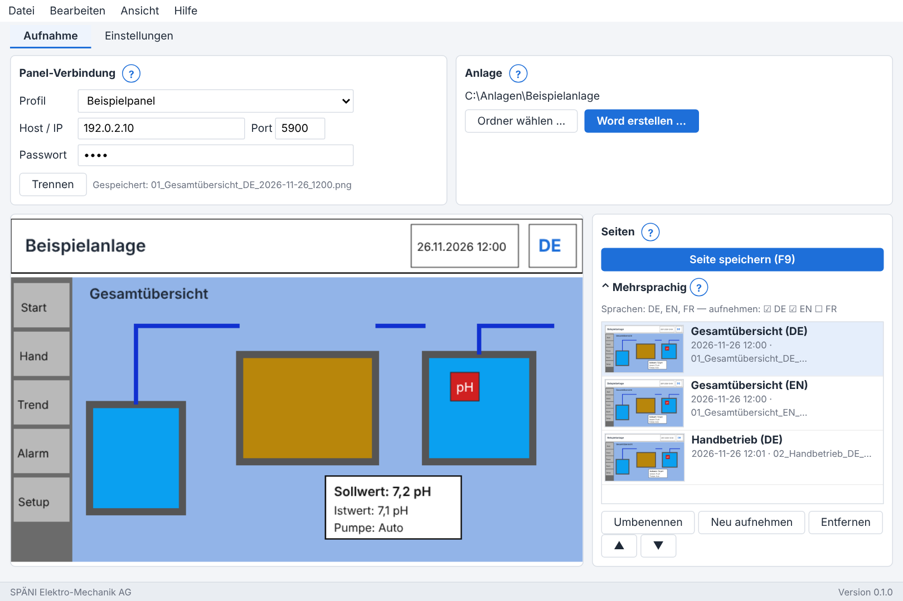

# HMI-ImageExport

Zeigt Touch-Panels (HMI) per VNC an, speichert Seiten als Screenshots und erstellt daraus ein Word-Dokument für die Anlagendokumentation. Getestet mit Siemens-Panels (Sm@rtServer).

*Schematische Darstellung der Oberfläche mit Beispieldaten.*

## Funktionen

- VNC-Verbindung zum Panel (Host, Port, Passwort), Panel-Bild im Fenster, Mausklick wird als Touch gesendet
- Seite speichern mit `F9`: Bild sofort als PNG im Anlagenordner, z. B. `01_Start_2026-11-26_1432.png`
- Seitenliste mit Vorschau, Umbenennen, Neu aufnehmen, Entfernen, Sortieren (Drag & Drop, Pfeiltasten), Doppelklick = Bild gross
- Mehrsprachige Panels: pro Seite alle oder ausgewählte Sprachen automatisch durchschalten und aufnehmen
- Word-Export ohne Word-Installation: ein Bild pro Seite, auf Seitenbreite skaliert, optional Beschreibungszeile und Deckblatt
- Verbindungsprofile, Passwörter verschlüsselt (Windows-DPAPI)
- Oberfläche und Hilfe auf Deutsch und Englisch, Update-Hinweis über GitHub Releases

## Installation

1. Aktuelle ZIP-Datei unter [Releases](https://github.com/SPAENI-AG/HMI-ImageExport/releases) herunterladen und entpacken.
2. `HMIImageExport.exe` starten. Es ist keine Installation und kein .NET nötig (Windows 10/11, 64 Bit).

Die EXE ist derzeit nicht digital signiert. Windows SmartScreen kann beim ersten Start warnen: «Weitere Informationen» › «Trotzdem ausführen». Die Prüfsumme (`.sha256`) liegt dem Release bei.

## Bedienung (Kurzfassung)

1. Profil oder Host/IP, Port (meist 5900) und Passwort eingeben, **Verbinden**.
2. Seite am Panel aufrufen, `F9` drücken, Seitenname eingeben.
3. Alle Seiten aufnehmen, Reihenfolge prüfen, **Word erstellen …**.

Ausführliche Hilfe: `F1` im Programm (lokal im Browser, DE/EN). Hinweis: Viele Panels erlauben nur eine VNC-Verbindung gleichzeitig; einen offenen VNC-Viewer vorher schliessen.

## Sicherheit und Datenschutz

- Passwörter werden nur verschlüsselt gespeichert und nie im Klartext geschrieben oder protokolliert.
- VNC überträgt Bilder unverschlüsselt und schützt das Passwort nur schwach: nur im Anlagennetz verwenden.
- Screenshots können Kundendaten enthalten. Anlagenordner nicht im Repository oder öffentlich ablegen.

Sicherheitslücken bitte gemäss [SECURITY.md](SECURITY.md) melden.

## Entwicklung

- .NET 10 SDK; die WPF-App läuft nur unter Windows, Core und Tests auch unter Linux
- Tests: `dotnet run --project tests/HMIImageExport.Tests`
- Bauen: `dotnet build HMI-ImageExport.slnx`
- Starten: `dotnet run --project src/HMIImageExport.App`
- Aufbau und Entscheide: [docs/konzept.md](docs/konzept.md), Beiträge: [CONTRIBUTING.md](CONTRIBUTING.md), Änderungen: [CHANGELOG.md](CHANGELOG.md)

## Lizenz

[MIT](LICENSE) © SPÄNI Elektro-Mechanik AG
